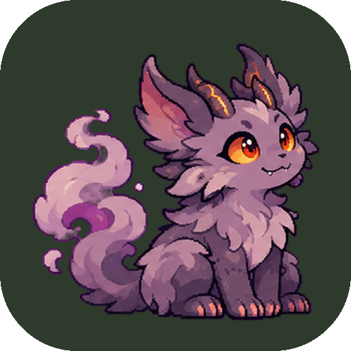
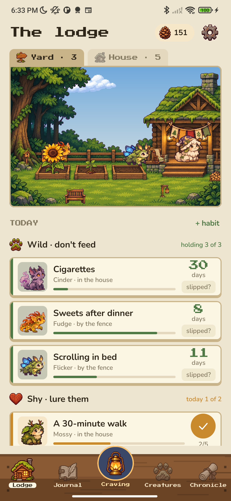
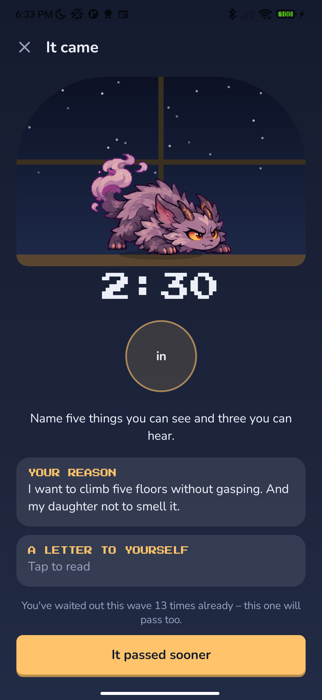
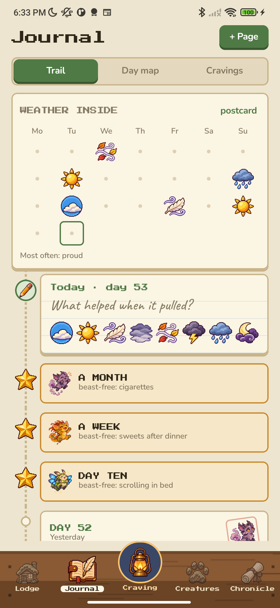
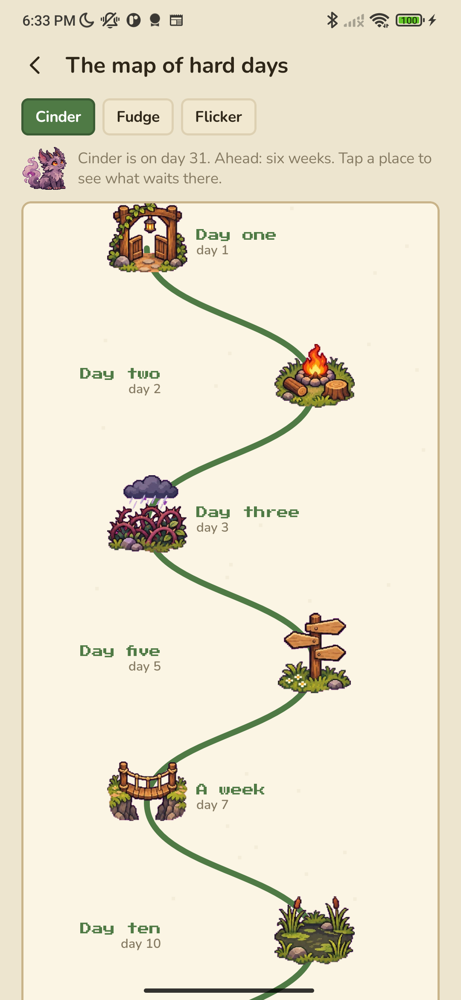

<p align="center"></p>

<h1 align="center">Wildling</h1>

<p align="center">Tame your habits: the bad ones are wild beasts, the good ones shy little creatures.<br>
<a href="https://bigdevwhale.github.io/stillcraft/apps/wildling/">Website</a> · <a href="https://github.com/bigdevwhale/wildlings/releases/latest/download/Wildling.apk">Download APK</a> · <a href="README.ru.md">Русский</a></p>

Every bad habit is a wild beast from the thicket. It comes for its due, you don't feed it, and day by day it comes closer: first a shadow between the trees, then eyes at the forest edge, then by the fence, on the porch, and at last asleep by the hearth. A good habit is a shy creature: the more often you do it, the bolder it steps out of the grass. A slip doesn't send you back to the start – the beast only takes a step back.

<p align="center">




</p>

## What's inside

- **48 invented creatures.** 12 wild and 12 shy ones for ready habits – smoking, alcohol, sweets, scrolling in bed, walks, water, reading, bed on time and more. 11 more of each for habits you name yourself, and 4 rare guests.
- **The yard and the house.** Creatures stand where trust has brought them: in the thicket, at the forest edge, by the fence, on the porch. The house, cut open, has a kitchen, a living room with a hearth, a bedroom and an attic. Clouds drift by day; windows glow at night.
- **«It came».** When it pulls, tap the lantern: the beast comes to the window and you wait out the wave together. Four minutes, breathing, simple things to do, your own reason and a letter you wrote yourself on a good day.
- **The journal trail.** A few words a day and the weather inside instead of emoji. Each page remembers its day on the way; milestones like «A week» and «A month» stand right on the trail.
- **The map of hard days.** From the gate of day one to the lodge on the hill a year on: what usually happens on day three, after a week, after a month. Places you haven't reached yet stay grey.
- **Cravings, watched.** The hours the beast comes, the sea of waves this month, what brings it and notes of what helps.
- **The chronicle.** Money and time won back, each creature's way to the hearth, records, this month against the last, the hard days of the week, and how the weather inside goes with your habits.
- **Pinecones** for clean days, habits done and cravings sat out, spent on seeds for the garden beds and things for the yard and the house.
- **Postcards:** a creature, the chronicle, a milestone, the weather inside, the whole lodge.
- No punishment, light and dark themes, Russian and English.

## Install

Download [Wildling.apk](https://github.com/bigdevwhale/wildlings/releases/latest/download/Wildling.apk) on a phone with Android 9 or later, open it and allow installs from that source when Android asks.

## Privacy

No ads, no account, no analytics. The app never goes online: habits, the journal and the creatures stay on your phone. See [PRIVACY.md](PRIVACY.md).

## Build

JDK 17+ (Android Studio's JBR works) and the Android SDK.

```
./gradlew assembleDebug
./gradlew assembleDebug -Pdemo -Pdemolang=ru   # app.wildling.demo: two months of life with habits
./gradlew testDebugUnitTest -Prender --tests '*RenderScreens*'   # every screen and postcard to app/build/art
```

Kotlin, Jetpack Compose, Room, DataStore, WorkManager. The creature, lodge and item art was made with AI image generation (`tools/gen_art.py`, `tools/cut.py`).

## License

MIT, see [LICENSE](LICENSE).

Wildling is one of the [StillCraft](https://bigdevwhale.github.io/stillcraft/) apps.
