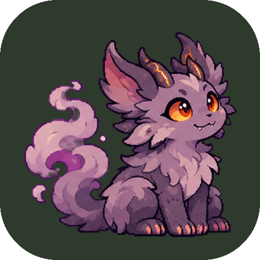
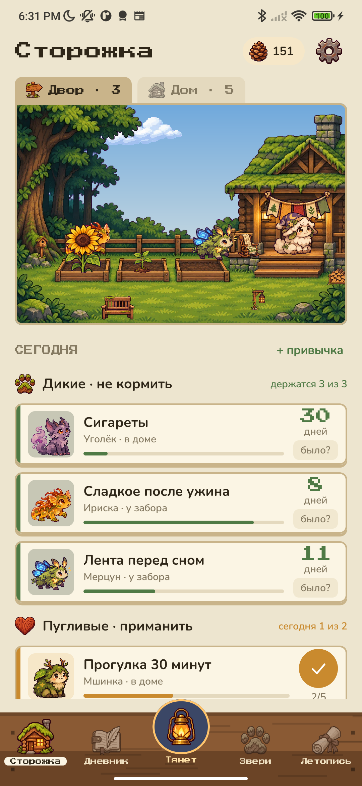
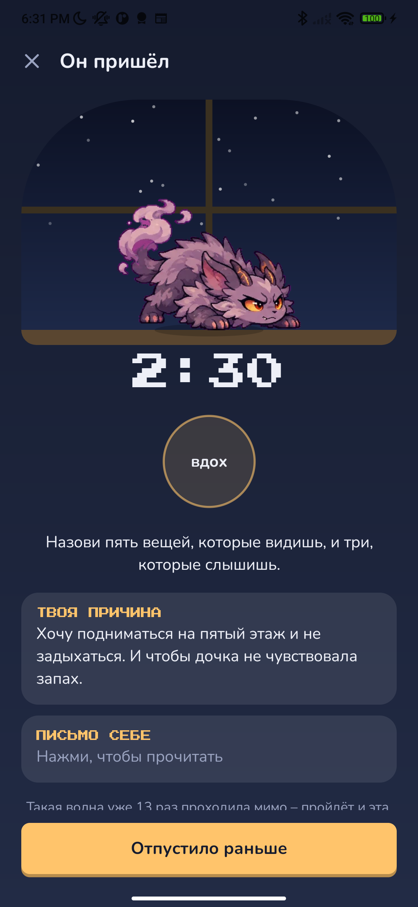
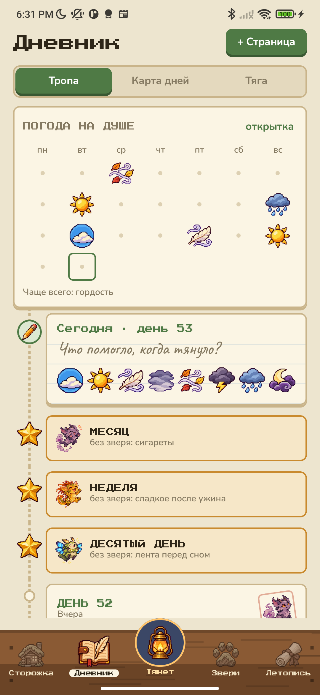
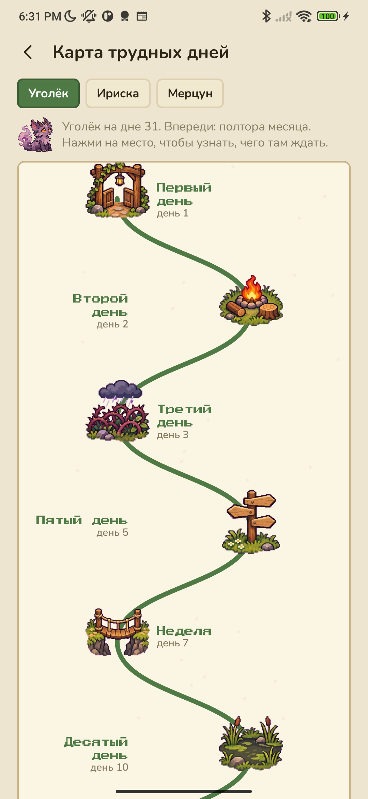

<p align="center"></p>

<h1 align="center">Wildling</h1>

<p align="center">Приручи свои привычки: вредные здесь – дикие звери, полезные – пугливые зверьки.<br>
<a href="https://bigdevwhale.github.io/stillcraft/apps/wildling/">Сайт</a> · <a href="https://github.com/bigdevwhale/wildlings/releases/latest/download/Wildling.apk">Скачать APK</a> · <a href="README.md">English</a></p>

Каждая вредная привычка – дикий зверь из чащи. Он приходит за своим, а ты его не кормишь, и день за днём он подходит ближе: сначала это тень между деревьями, потом глаза у опушки, потом он у забора, на крыльце и, наконец, спит у очага. Полезная привычка – пугливый зверёк: чем чаще ты её делаешь, тем смелее он выходит из травы. Срыв не отбрасывает к началу – зверь просто отступает на шаг.

<p align="center">




</p>

## Что внутри

- **48 придуманных существ.** 12 диких и 12 пугливых для готовых привычек – курение, алкоголь, сладкое, лента перед сном, прогулки, вода, чтение, сон вовремя и другие. Ещё по 11 зверей для привычек, которые ты назовёшь сам, и 4 редких гостя.
- **Двор и дом.** Звери стоят там, куда их привело доверие: в чаще, у опушки, у забора, на крыльце. В доме, показанном в разрезе, есть кухня, гостиная с очагом, спальня и чердак. Днём по небу плывут облака, ночью горят окна.
- **«Он пришёл».** Когда тянет, нажми на фонарь: зверь подойдёт к окну, и вы вместе переждёте волну. Четыре минуты, дыхание, простые подсказки, твоя причина и письмо самому себе, написанное в хороший день.
- **Дневник-тропа.** Пара слов в день и погода на душе вместо смайликов. Каждая страница помнит свой день пути, а вехи вроде «Неделя» и «Месяц» стоят прямо на тропе.
- **Карта трудных дней.** От ворот первого дня до сторожки на холме через год: что обычно бывает на третий день, через неделю и через месяц. Места, до которых ещё не дошёл, пока серые.
- **Тяга под присмотром.** В какие часы приходит зверь, море волн за месяц, что его приводит и записки о том, что помогает.
- **Летопись.** Сколько вернулось денег и времени, путь каждого зверя к очагу, рекорды, этот месяц против прошлого, трудные дни недели и то, как погода на душе связана с привычками.
- **Шишки** за чистые дни, сделанные привычки и пережитые тяги. На них можно купить семена для грядок и вещи для двора и дома.
- **Открытки:** зверь, летопись, веха пути, погода на душе и вся сторожка.
- Никаких наказаний, светлая и тёмная темы, русский и английский.

## Установка

Скачай [Wildling.apk](https://github.com/bigdevwhale/wildlings/releases/latest/download/Wildling.apk) на телефон с Android 9 или новее, открой файл и разреши установку из этого источника, когда Android спросит.

## Приватность

Без рекламы, аккаунта и аналитики. Приложение вообще не выходит в интернет: привычки, дневник и звери хранятся только на телефоне. Подробнее – [PRIVACY.md](PRIVACY.md).

## Сборка

JDK 17+ (подойдёт JBR из Android Studio) и Android SDK.

```
./gradlew assembleDebug
./gradlew assembleDebug -Pdemo -Pdemolang=ru   # app.wildling.demo: два месяца жизни с привычками
./gradlew testDebugUnitTest -Prender --tests '*RenderScreens*'   # все экраны и открытки в app/build/art
```

Kotlin, Jetpack Compose, Room, DataStore, WorkManager. Звери, сторожка и вещи нарисованы с помощью генерации изображений (`tools/gen_art.py`, `tools/cut.py`).

Wildling – одно из приложений [StillCraft](https://bigdevwhale.github.io/stillcraft/).
